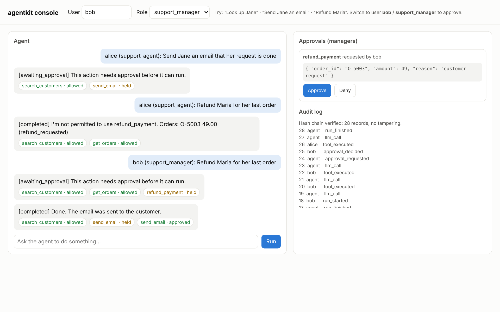
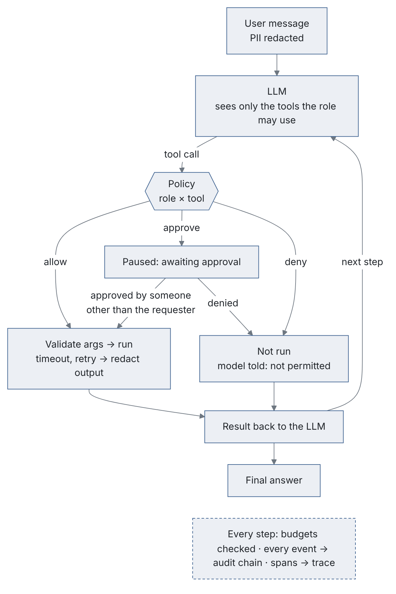

<div align="center">

<picture>
  <source media="(prefers-color-scheme: dark)" srcset="docs/img/logo-dark.svg">
  
</picture>

<p><em>A starter kit for internal AI agents that security teams can sign off: role policies, human approvals, PII redaction and a tamper-evident audit log.</em></p>

[](https://github.com/faizanreza-cs/agentkit-enterprise/actions/workflows/ci.yml)


[](https://www.linkedin.com/in/faizanreza)
[](https://x.com/cs_faizan)

</div>

## ⚡ Overview

Most agent demos call tools freely. Security and compliance teams block those in review. This
kit answers their questions up front:

| Question from security / compliance | Answer in agentkit |
|---|---|
| *Who can make the agent do what?* | YAML policy per role: each tool is `allow`, `approve` or `deny`, default-deny. Denied tools are hidden from the model **and** blocked at execution, even if the model calls them anyway |
| *Can it email customers or move money on its own?* | High-risk tools pause the run until an approver decides. **Separation of duties:** you can't approve your own request |
| *Does customer data go to the LLM?* | Emails, phones, cards (Luhn-checked) and SSNs are masked before reaching the model, logs or answers. Tools take customer ids and resolve contact details themselves |
| *Can we prove what happened?* | Every message, tool call, approval and decision goes to a **hash-chained audit log**. Editing or deleting any record breaks the chain, and `verify()` finds it. Ship the `head` hash it returns to your log store, so deleting the newest records is caught too |
| *What stops a runaway loop or a surprise bill?* | Step limits, per-run token budget, per-user daily budget, per-tool timeouts and retries |
| *How do we know it behaves?* | A governance eval checks *actions*, not just words: approvals held, denied tools never ran, no raw PII in the model context |



## How a run works

<p align="center">
<picture>
  <source media="(prefers-color-scheme: dark)" srcset="docs/img/run-dark.png">
  
</picture>
</p>

## Quickstart

```bash
git clone https://github.com/faizanreza-cs/agentkit-enterprise && cd agentkit-enterprise
make setup
make api          # operator console at http://localhost:8000 (offline mock planner)
```

From the CLI:

```bash
agentkit --user alice --role support_agent run "Send Jane an email that her request is done"
#  [awaiting_approval] ... awaiting approval 3f9c2a...: send_email {...}
agentkit --user bob --role support_manager approve 3f9c2a...
agentkit --user bob --role support_manager audit
```

With a real model:

```bash
export ANTHROPIC_API_KEY=...  AGENTKIT_MODEL=<anthropic model id>
make api
```

## Adapt it to your company

1. **Add tools** with a Pydantic argument model. The schema the model sees and the validation
   come from the same class:

   ```python
   @registry.tool(description="Issue a credit note", risk="high", timeout_s=10)
   def issue_credit(args: CreditNote) -> dict: ...
   ```

2. **Write the policy** in `policies/default.yaml`: roles, decisions per tool, and approver
   roles.
3. **Plug in identity.** Replace `identity()` in `agentkit/api.py` with your SSO or OIDC
   dependency; roles come from your IdP groups.
4. **Swap storage** if needed. `Store` is SQLite; the interface maps directly onto Postgres.

| Setting | Default | Meaning |
|---|---|---|
| `AGENTKIT_PROVIDER` | `auto` | `anthropic`, `openai`, `mock` |
| `AGENTKIT_MODEL` | none | model id |
| `AGENTKIT_POLICY` | `policies/default.yaml` | policy file |
| `AGENTKIT_MAX_STEPS` | `8` | LLM turns per run |
| `AGENTKIT_MAX_RUN_TOKENS` | `60000` | token budget per run |
| `AGENTKIT_DAILY_USER_TOKENS` | `500000` | token budget per user per day |
| `AGENTKIT_DB` | `data/agentkit.db` | runs, approvals, usage, audit |

## Tests and evals

- **20 tests.** Redaction, including checksum false-positive guards. Policy default-deny,
  typo rejection and unknown tool names. Audit-chain tamper and deletion detection. The
  approval flow with separation of duties, and approvals that can only be decided and resumed
  once. A rogue model calling a tool it was never offered. Invalid arguments. Runaway-loop
  budgets. Tool timeout and retry, and timed-out high-risk tools that are never retried. The
  full API with role checks.
- **Governance eval** (`make eval`). Eight tasks across three roles, scored on what actually
  executed. 8/8 with the mock planner; run `make eval-llm` to score a real model under the
  same rules.

Writing the tests caught a real bug: a tool that failed once and then succeeded on retry was
still reported as an error. It's fixed, and a test covers it.

## License

MIT
